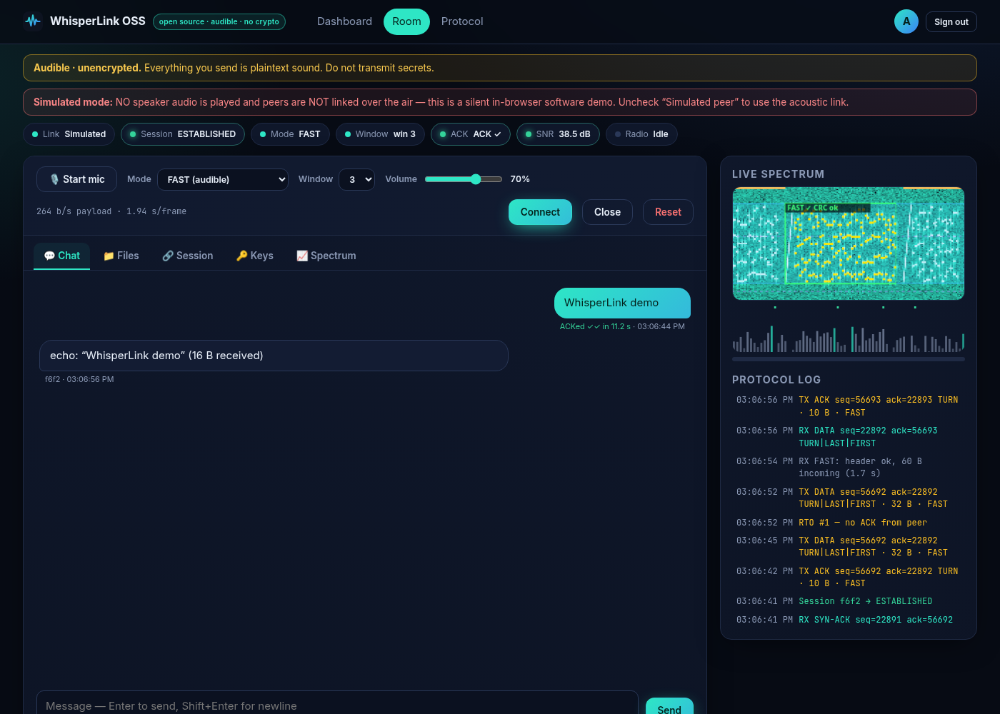
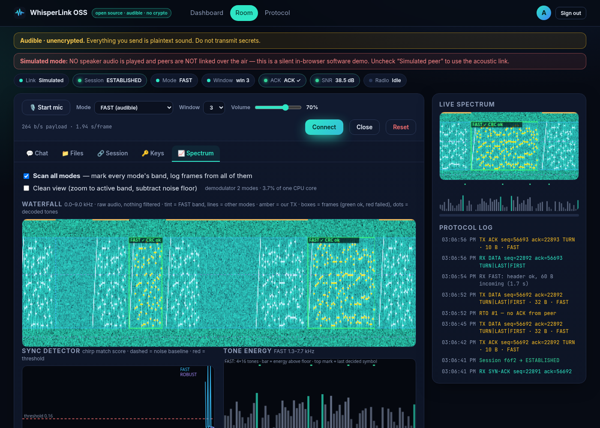
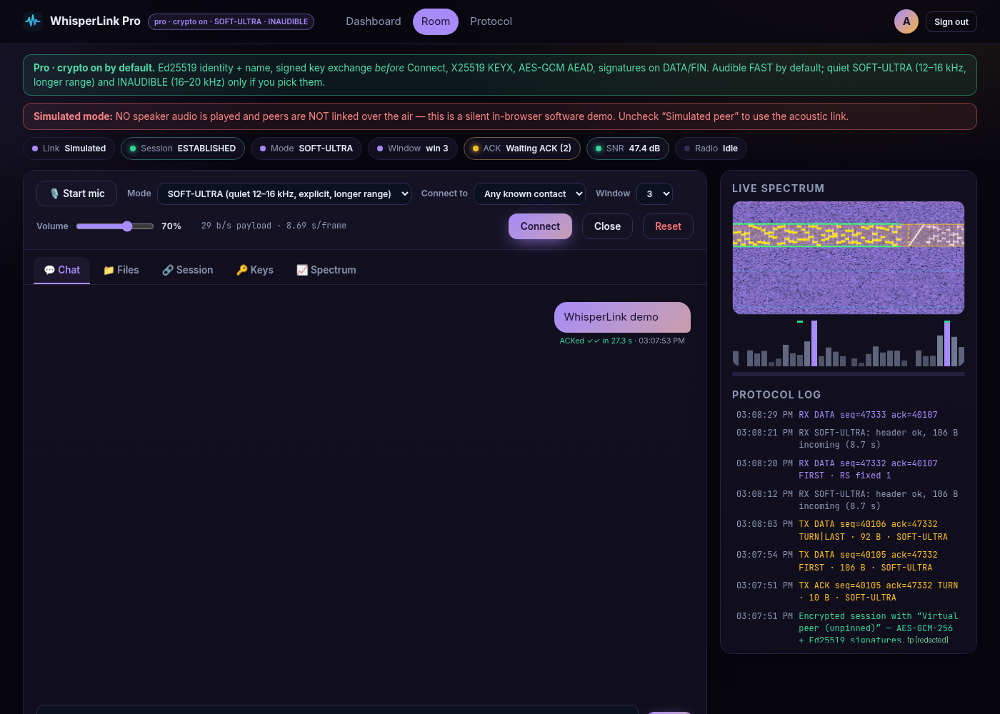
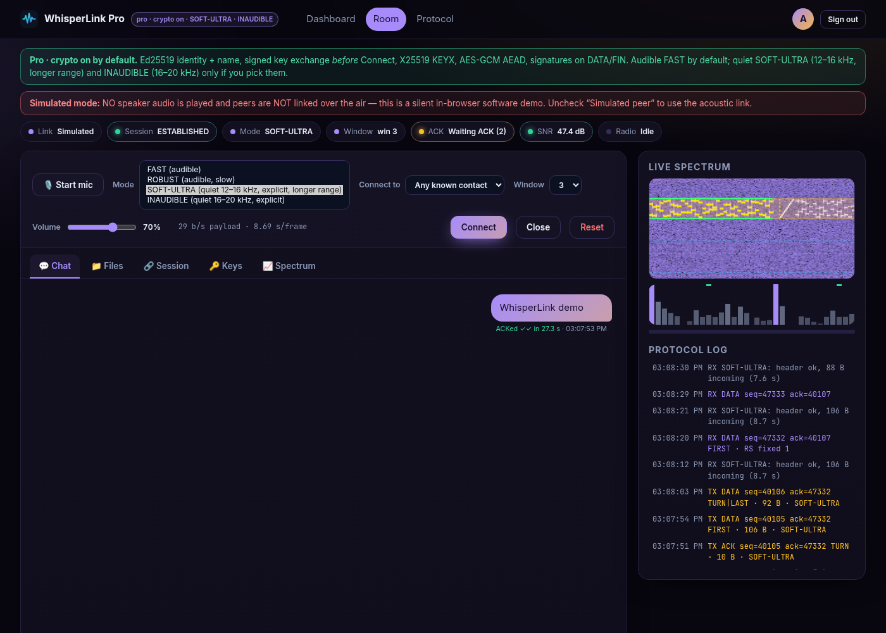

# WhisperLink

Open-source audible audio modem for the browser, by Antonio Brandao.

WhisperLink sends data through the air: the speaker plays tones, the microphone hears them, and the Flask server never relays the payload. Two browsers in the same room (or one browser talking to a simulated peer) exchange chat, files, and session control as sound.

This repository is the **open edition**. It is audible and unencrypted by design. Anyone in earshot can record and decode what you send.

**License:** MIT. See [LICENSE](LICENSE).

## 30-second demo

<video src="docs/whisperlink-30s.mp4" width="720" controls>
  <a href="docs/whisperlink-30s.mp4">Watch the 30-second demo (MP4)</a>
</video>

[Watch in this repo](docs/whisperlink-30s.mp4) · [Download](https://whisperlink.abrandao.net/whisperlink-30s.mp4)

## Live demos

| Edition | URL |
| --- | --- |
| Open | https://whisperlink.abrandao.net/whisperlink/ |
| Pro (demo only, closed source) | https://whisperlink.abrandao.net/whisperlink-pro/ |

The site entry https://whisperlink.abrandao.net/ redirects to the open edition. Microphone access requires HTTPS (or `localhost`).

## Open-edition features

- **FAST** audible mode (~1.3–7.7 kHz, about 264 b/s payload). Four parallel 16-tone MFSK bands with a chirp preamble, training symbols, Reed–Solomon, and CRC.
- **ROBUST** audible mode (~0.7–5.1 kHz, slower, more noise margin). Two bands, longer symbols, more parity.
- **ACK/SACK session layer.** TCP-like SYN / SYN-ACK / ACK handshake, sequence numbers, cumulative ACK plus selective ACK, sliding window, half-duplex turn-taking, listen-before-talk, retransmission with timeouts, keepalive, and FIN/RST. Loss triggers **FAST → ROBUST fallback**; the session can return to FAST after clean bursts.
- **Rooms and chat.** Delivery ticks on each bubble; click an un-ACKed message to resend the real segments. Small file transfer over the same session.
- **Spectrum.** Raw full-band waterfall; highlighted frames (box at frame start, decoded-tone marks, green CRC-ok / red failed); optional clean view (zoom to the active band, subtract the noise floor); **tone energy** bars; **sync detector** meter and history; **Scan all modes** decoded-frame log (time, mode, band, SNR, CRC, header, payload preview) and demodulator CPU load.
- **Simulated peer.** In-browser, silent software demo — no speaker audio, peers are not linked over the air. Uncheck it to use the real acoustic path. Acoustic self-test is also available.
- **Accounts.** Login, optional self-registration, admin user management, forced password change, CSRF protection, and a strict Content-Security-Policy.

The demodulator band-passes each mode before detection and subtracts a per-tone noise floor. That helps with hum and whines; it is not a range claim.

## Quick start

Requires Python 3.12+ and Node.js (for the JavaScript checks and modem tests).

```bash
python3 -m venv .venv
source .venv/bin/activate
pip install -r requirements.txt
flask --app wsgi run
```

Open http://127.0.0.1:5000/ and sign in with a seeded account (see [Demo logins](#demo-logins-open-edition)). Tick **Simulated peer** (on by default), press **Connect**, then send a chat message.

Production-style serve (example, mounted at `/whisperlink`):

```bash
APPLICATION_ROOT=/whisperlink gunicorn -w 2 -b 127.0.0.1:5057 wsgi:application
```

### Tests

```bash
pytest
node --check chirp_oss/static/js/*.js tests/*.js
```

Offline modem and session checks (optional, slower):

```bash
node tests/modem.test.js          # also: SR=44100 node tests/modem.test.js
node tests/scan.test.js
node tests/resend.test.js
LOSS=0 node tests/session.test.js
LOSS=0.15 node tests/session.test.js
node tests/acoustic.test.js
MODE=ROBUST node tests/acoustic.test.js
```

## Configuration

| Variable | Default | Purpose |
| --- | --- | --- |
| `CHIRP_INSTANCE` | `<repo>/instance` | Flask instance folder (created on first run) |
| `CHIRP_DB` | `instance/users.db` | SQLite user database |
| `CHIRP_SECRET_KEY` | generated into `instance/secret_key` | Flask session secret |
| `CHIRP_ALLOW_REGISTRATION` | `1` | Set `0` / `false` / `no` to disable self-registration |
| `CHIRP_COOKIE_SECURE` | `0` | Set `1` on HTTPS so the session cookie is Secure |
| `CHIRP_ADMIN_PASSWORD` | `admin-change-me` | Seed password for the local `admin` account only |
| `APPLICATION_ROOT` | *(empty)* | URL prefix when reverse-proxied (e.g. `/whisperlink`) |

On first start the app seeds `admin`, `demo`, `alice`, and `bob` with `*-change-me` placeholders if those usernames are missing. Those values are not the live-site passwords. Do not commit `instance/`, `*.db`, or `secret_key`.

Create extra users with `flask --app wsgi create-user` (`USERNAME_NEW`, `PASSWORD_NEW`, `ADMIN_NEW=1`).

## Honest limits

- **Audible and unencrypted.** Everything you send is plaintext sound. Do not transmit secrets. Anyone nearby can decode; a nearby speaker can inject.
- **Distance depends on hardware and the room.** Speakers, microphones, volume, and acoustics set what actually works. This project does not publish measured range numbers.
- **Browser microphone permissions.** The real acoustic link needs a mic, typically on HTTPS or `localhost`. Simulated peer works without a microphone and without playing speaker audio.
- FAST and ROBUST are the only modes in this edition. There is no encryption, no key exchange, and no quiet / ultrasonic mode here.

## Open vs Pro

Pro is a separate, **closed-source** product. The comparison below is descriptive only. The open edition makes **no cryptographic claims**.

| | Open (this repo) | Pro (closed source) |
| --- | --- | --- |
| Source | MIT, this repository | Closed source |
| Modes | FAST and ROBUST (audible) | Those, plus quiet **SOFT-ULTRA** (12–16 kHz) and **INAUDIBLE** (16–20 kHz) |
| Traffic | Plaintext sound | Ed25519 signatures, X25519 key exchange over sound, HKDF, AES-GCM-256 |
| Contacts | None | Named contacts (introduce, then connect by name) |
| Default | Audible, no crypto | Crypto on; quiet modes only if you pick them |

SOFT-ULTRA may still be faintly audible to some listeners. Quiet modes in Pro do not auto-switch to audible. Range still depends on hardware; no range numbers are claimed.

## Demo logins (open edition)

These passwords work only on the Open live demo at https://whisperlink.abrandao.net/whisperlink/ :

| Username | Password |
| --- | --- |
| `demo` | WhisperLinkDemo!42 |
| `alice` | WhisperLinkAlice42 |
| `bob` | WhisperLinkBob!4242 |

The Pro demo uses separate private credentials. Do not store real data on the public demo.

A fresh local install uses the `*-change-me` seed placeholders in the source, not the live demo passwords.

## Screenshots

**Open chat with ACK**



**Open spectrum with highlighted frames**



**Pro encrypted room in SOFT-ULTRA**



**Pro mode list**


